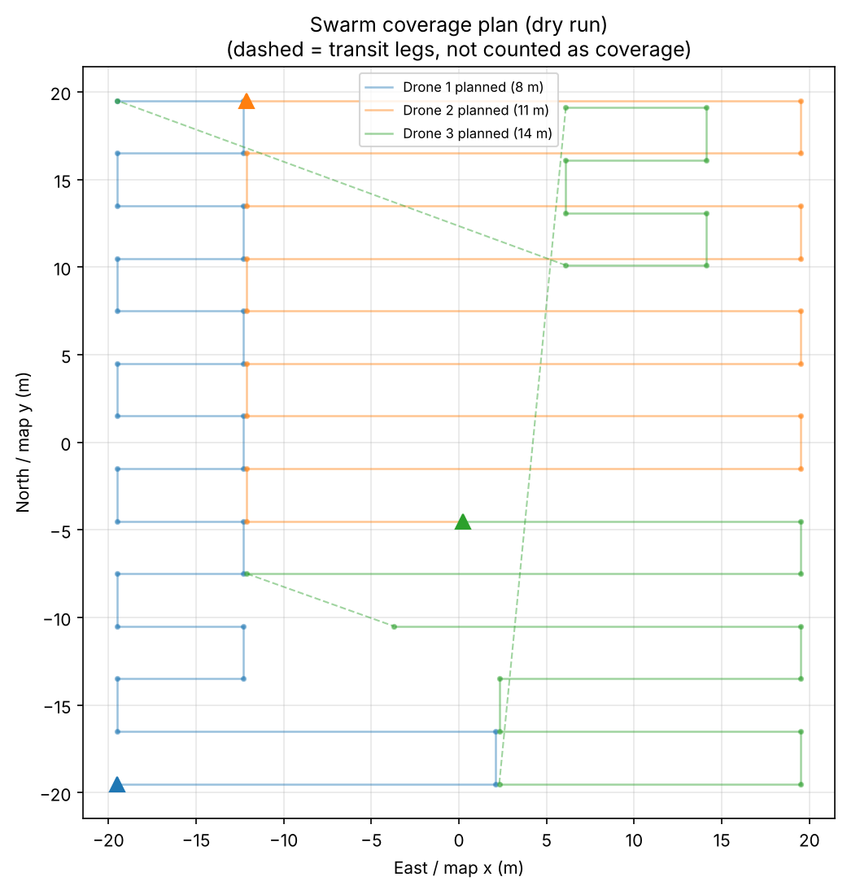
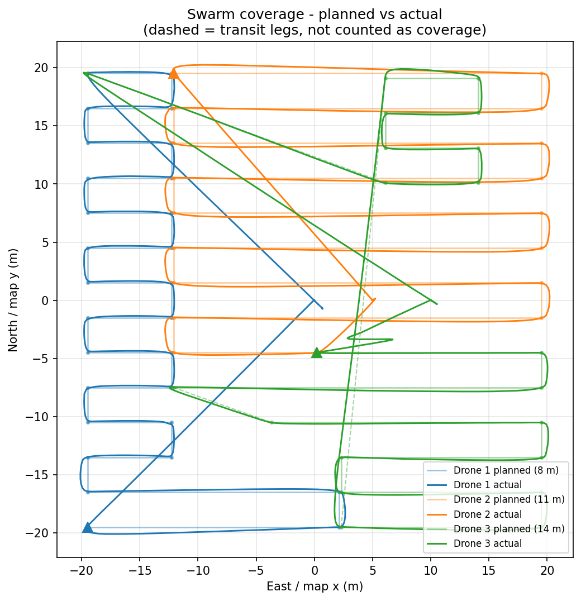
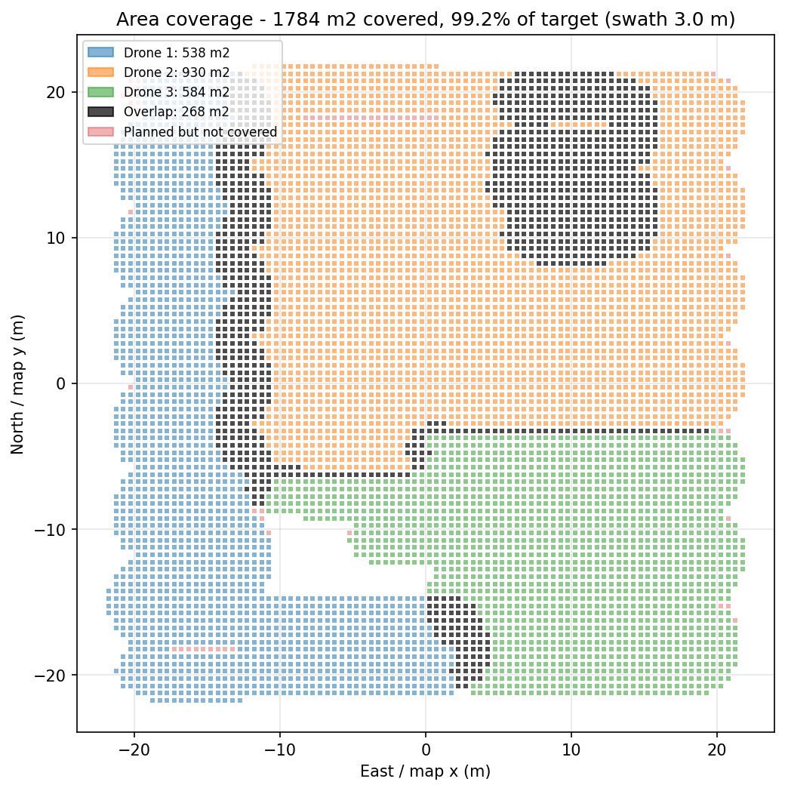
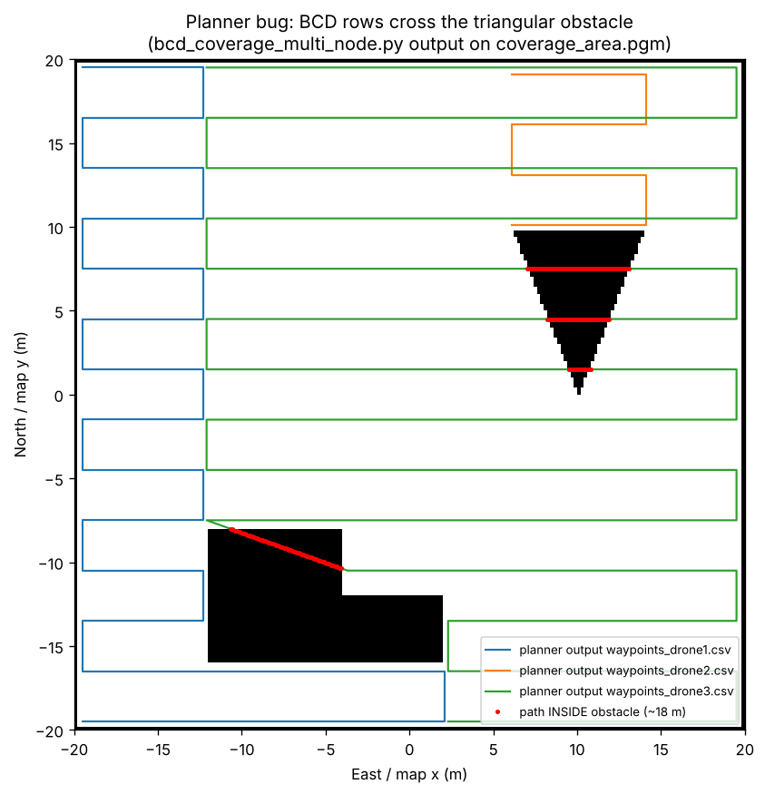

# 🚁 Boustrophedon Coverage with Obstacles: Single & Multi-UAV

> Part of the FYP **"AI-Powered Cooperative Drone Swarm for Autonomous Area Coverage and Object Detection"** (UET Taxila, Computer Engineering).
> Planner: ROS 2 (Humble) BCD coverage nodes · Flight: ArduPilot SITL (+ Gazebo) · Control: MAVSDK-Python 3.x (GUIDED offboard)

**Status (28 Oct 2026, evening):** the **3-drone swarm mission (`swarm_mission_mavsdk_v4.py`) flies cleanly in ArduPilot SITL**. All 67 waypoints were reached and all drones landed and disarmed. Coverage was **99.2 %** of the target area, the mission took **2:39 min**, the three coverage times were **1:19–1:21** (balanced by the time-based split), and there were **0 link drop-outs**.
⚠ Known open issue: the **planner's rows cross the triangular obstacle**; the fix is next ([section 7](#7-known-issues-and-next-steps)).

---

## Table of contents
1. [Repository structure](#1-repository-structure)
2. [Progress log](#2-progress-log)
3. [How to run the 3-drone mission (step by step)](#3-how-to-run-the-3-drone-mission-step-by-step)
4. [How the swarm mission works](#4-how-the-swarm-mission-works)
5. [Mission results](#5-mission-results)
6. [Problems we faced and how we solved them](#6-problems-we-faced-and-how-we-solved-them)
7. [Known issues and next steps](#7-known-issues-and-next-steps)
8. [Earlier results](#8-earlier-results)
9. [Single-UAV BCD coverage (detailed write-up)](#single-uav-autonomous-coverage-using-boustrophedon-cellular-decomposition)

---

## 1. Repository structure

```text
coverage_ws/
├── src/
│   ├── coverage_planner/                     # ROS 2 package (ament_python)
│   │   └── coverage_planner/
│   │       ├── bcd_coverage_node.py          # grid-based BCD, single UAV  -> waypoints.csv
│   │       ├── bcd_geometric_planner.py      # geometric (polygon) BCD
│   │       ├── coverage_planner_node.py      # first simple lawnmower planner
│   │       ├── bcd_coverage_multi_node.py    # BCD + split into 3 regions -> waypoints_drone{1,2,3}.csv
│   │       └── multi_drone_formation_controller.py   # early MAVROS formation test (not used)
│   │
│   ├── swarm_mission_mavsdk_v4.py            # ★ CURRENT 3-drone mission (use this one)
│   ├── swarm_mission_mavsdk_v3.py            # v3: per-run output folders, own mavsdk_server
│   ├── swarm_mission_mavsdk_v2.py            # v2: time split, progress timeouts (writes into ~/coverage_map!)
│   ├── swarm_mission_mavsdk.py               # v1: first rewrite (writes into ~/coverage_map!)
│   ├── multi_drone_offboard_mission.py       # original 3-drone script (24 Aug, kept for reference)
│   ├── region_partitioner.py, plot_combined_coverage.py   # older helpers
│   ├── mission_executor.py                   # single-UAV MAVSDK mission (AUTO) + GPS logging
│   ├── mavsdk_waypoint_follower.py           # single-UAV offboard waypoint follower
│   └── path_plotter.py                       # single-UAV planned-vs-actual plot
│
└── docs/
    ├── images/                               # figures used in this README
    ├── results/2026-10-28/                   # first SITL+Gazebo mission (v1 script)
    ├── results/2026-10-28_v4_sitl/           # clean mission with v4 (built-in SITL)
    └── README_backup_2026-10-28_1801.md      # previous version of this README
```

ROS 2 entry points (`ros2 run coverage_planner <name>`): `bcd_coverage_node`, `bcd_geometric_node`, `coverage_planner_node`, `multi_drone_node`, `swarming_node`.

**Data folders.** `~/coverage_map/` holds the **inputs**: the map (`coverage_area.pgm/.yaml`) and the planner CSVs. From v3 on, every run writes its outputs into a **new folder** and never overwrites anything:
```text
~/coverage_map/missions/2026-10-28_19-38-12_flight/     # one folder per run (_flight, _dryrun, _replot_of_...)
    mission_info.txt  mission_summary.txt  mission_metrics.txt/.csv
    swarm_planned_vs_actual.png  coverage_map.png
    actual_path_droneN.csv  flown_waypoints_droneN.csv  mavsdk_server_droneN.log
```

---

## 2. Progress log

| Date | Milestone |
|---|---|
| 12 Aug 2026 | First lawnmower planner on a ROS 2 occupancy map |
| 13–15 Aug | Grid-based **BCD with obstacles** and **geometric BCD**; single-UAV SITL flight with GPS logging and planned-vs-actual plot |
| 20–21 Aug | First swarm attempt: MAVROS formation controller (stopped: arming problem) |
| 22–24 Aug | **3-drone BCD coverage with MAVSDK**: 3-way split, separate gRPC ports, hold-based collision avoidance |
| 28 Oct (afternoon) | **v1 `swarm_mission_mavsdk.py`**: code review, 10+ bugs fixed, equal-length split, altitude layers, predictive 3-D avoidance, safe return, metrics report; first mission in SITL + Gazebo (98.5 % coverage, but slow) |
| 28 Oct (evening) | **v2**: time-based split, progress-based timeouts, auto-disarm, transit vs coverage legs · **v3**: per-run output folders, own `mavsdk_server` with logs · **v4**: pre-flight link check. Root cause of the crashes found (Gazebo at ~10 % real-time speed). **Clean 3-drone mission with v4 in built-in SITL: 99.2 %, 2:39 min** |

---

## 3. How to run the 3-drone mission (step by step)

**One-time checks**
```bash
pip3 show mavsdk | grep Version     # tested with mavsdk-python 3.15.3
pip3 install matplotlib             # plots + coverage map
```
Close QGroundControl (it takes UDP 14550, which drone 1 needs), or see the tip at the end of this section.

**Step 1: start 3 ArduPilot SITL drones (3 terminals)**

**Option A: built-in ArduPilot physics (recommended, used for the v4 results).** It is light and runs in real time. Drones start 5 m apart:
```bash
cd ~/ardupilot/ArduCopter
sim_vehicle.py -v ArduCopter -I0 --sysid 1 --custom-location=-35.3632620,149.1652380,584,0 --console   # Drone 1 -> UDP 14550
sim_vehicle.py -v ArduCopter -I1 --sysid 2 --custom-location=-35.3632620,149.1652931,584,0 --console   # Drone 2 -> UDP 14560
sim_vehicle.py -v ArduCopter -I2 --sysid 3 --custom-location=-35.3632620,149.1653482,584,0 --console   # Drone 3 -> UDP 14570
```
**Option B: Gazebo.** Start the world first (`gz sim -v4 -r <your_3_drone_world>.sdf`, or `gz sim -s -r ...` without the window, which is much faster), then run the same commands with `-f gazebo-iris --model JSON` instead of `--custom-location=...`.
> ⚠ Gazebo's **Real Time Factor (RTF)** must be close to 100 %. At ~10 % the MAVLink heartbeat drops out and MAVSDK crashes ([problem 18](#64-problems-found-in-the-evening-runs-v2v4)). The v4 link check will then refuse to arm.
> ⚠ **Do not add `--out=udp:...`.** `-I N` already sends to port 14550 + 10·N ([problem 12](#63-problems-during-the-first-sitl-bring-up)).

Wait until every console shows a GPS fix (`EKF3 IMU0 is using GPS`).

**Step 2: waypoints (only for a new plan).** In every ROS 2 terminal: `source /opt/ros/humble/setup.bash && source ~/coverage_ws/install/setup.bash`.
```bash
ros2 run nav2_map_server map_server --ros-args -p yaml_filename:=$HOME/coverage_map/coverage_area.yaml   # leave running
ros2 run nav2_util lifecycle_bringup map_server
ros2 run coverage_planner multi_drone_node          # -> ~/coverage_map/waypoints_drone{1,2,3}.csv, then Ctrl+C
```
If the CSVs already exist, skip this step; the mission script re-balances the work anyway.

**Step 3: dry run (optional, nothing flies)**
```bash
cd ~/coverage_ws/src
python3 swarm_mission_mavsdk_v4.py --dry-run        # -> ~/coverage_map/missions/<time>_dryrun/swarm_plan_dry_run.png
```

**Step 4: fly**
```bash
pkill -f mavsdk_server                              # clear leftovers from earlier runs
python3 swarm_mission_mavsdk_v4.py 2>&1 | tee ~/coverage_map/run_v4.log
```
The first line prints the new run folder. The script then:
1. connects to all drones and checks their health
2. runs a **20 s link check**
3. plans and splits the work
4. takes off, flies the coverage, returns home and lands
5. prints the **MISSION SUMMARY** and **MISSION METRICS**

**Ctrl+C once** makes every airborne drone land where it is.

Useful options: `--num-drones 2`, `--allow-partial`, `--split auto|time|length|planner`, `--no-layers`, `--ignore-link-check` (not recommended), `--plot-only [--run-dir <folder>]` (re-analyse a past flight into a new `_replot_of_...` folder).

**Tip (QGroundControl while flying):** in each MAVProxy console add an extra output on a *different* port (`output add 127.0.0.1:14551` / `14561` / `14571`). In QGC, add UDP links for those ports and turn off auto-connect to 14550.

---

## 4. How the swarm mission works

```text
 /map ─► bcd_coverage_multi_node (ROS 2) ─► waypoints_drone{1,2,3}.csv
                                                    │
 swarm_mission_mavsdk_v4.py (one mavsdk_server per drone, gRPC 50051/52/53, logs per drone)
   connect + health ─► 20 s LINK CHECK ─► measure each drone's origin ─► shared map frame
   join CSVs ─► cut into N pieces of EQUAL ESTIMATED TIME ─► nearest drone gets each piece
   arm ─► take off (ArduPilot default height) ─► climb to own layer (8/11/14 m)
   fly piece with 10 Hz position setpoints   ◄── collision monitor (10 Hz, 3-D, predictive)
   fly home at own layer ─► wait until nobody below ─► land ─► auto-disarm on ground
   ─► summary + metrics + plots into a NEW run folder
```

**4.1 Shared map frame.** Each ArduPilot instance measures position from its own origin. At start-up the script converts every origin into one shared frame, with map x = East and y = North (ROS ENU), and map (0, 0) = drone 1's origin unless `MAP_ORIGIN_LATLON` is set.

**4.2 Work split by estimated time (v2+).** The planner's paths are joined in order and cut into pieces of equal **estimated flight time**: distance / 1.5 m/s + 8 s per corner. This model was fitted on the first Gazebo run, where it predicted drone 3's coverage time almost exactly. ArduPilot slows down at every corner, so splitting by distance alone left the drone with the most corners finishing last. Each piece goes to the nearest drone, possibly reversed, and two drones never start at the same point. *Result in the v4 mission: coverage times 1:21 / 1:21 / 1:19.*

**4.3 Transit vs coverage legs (v2+).** Sweeps along x and the short steps between them are **coverage**. Diagonals and long jumps between cells are **transit**: they are drawn dashed in the plots and kept out of the area and overlap metrics.

**4.4 Altitude layers.** Each drone climbs straight up to its own cruise altitude (8 / 11 / 14 m) before leaving.

**4.5 Collision avoidance (10 Hz, 3-D).**

- **Who gives way:** a drone that is taking off or landing cannot be steered, so the other one always gives way. Otherwise the drone with the higher id gives way.
- **Conflict test:** conflicts are predicted from the velocities over a 3 s horizon, both horizontally and vertically.
- **HOLD:** if the other drone will pass by, the drone that gives way stops in place.
- **EVADE:** if the other drone is heading straight at it, or it is already within 2.5 m, it moves vertically away. It moves sideways instead from a drone that is taking off or landing.
- **No flicker:** a decision is kept until the other drone has really passed. A hold longer than 20 s turns into an evade.

**4.6 Return, landing, disarm.**

- Drones fly home at their own layer and wait until no drone is below them before landing.
- Landing is judged by actual descent progress, not a fixed timeout.
- A drone that is on the ground but still armed is disarmed by the script after 5 s.

**4.7 Robustness.**

- **Pre-flight link check (v4):** nothing is armed until the link has been watched for 20 s.
- **No command while a link is down:** commands are never sent while a drone's link is down, because MAVSDK 3.x aborts on that.
- **Progress-based timeouts:** a slow simulation is not mistaken for a failure.
- **Arming:** up to 3 tries.
- **Battery failsafe:** each drone returns home below 25 %.
- **Ctrl+C:** makes every drone land.
- **Crashed server:** if a `mavsdk_server` dies, its exit signal and last log lines are printed, and the other drones continue.

**4.8 Metrics** (computed from the logs, so `--plot-only` can redo them).

- **Per drone:** flight and coverage time, distance, speed, area covered (3 m swath), tracking error, and battery used / drain rate / mAh / estimated time left.
- **Swarm:** total mission time, coverage makespan, total area (union), coverage %, overlap, total battery, area per % battery, and minimum separation.

**Main settings** (top of the script)

| Setting | Default | Meaning |
|---|---|---|
| `DRONES` | UDP 14550/60/70, gRPC 50051/52/53, 8/11/14 m | connection + layer altitude per drone |
| `EST_SPEED_M_S`, `TURN_COST_S` | 1.5 m/s, 8 s | time model for the work split |
| `ACCEPTANCE_RADIUS_M` | 1.0 | waypoint reached (3-D) |
| `SAFE_DIST_M` / `EMERGENCY_DIST_M` / `VERTICAL_SAFE_M` | 5.0 / 2.5 / 2.0 | avoidance distances |
| `NO_PROGRESS_TIMEOUT_S` / `TAKEOFF_NO_PROGRESS_S` | 30 / 120 s | give up only after this long without progress |
| `LINK_CHECK_S` | 20 s | pre-flight link check |
| `SWATH_WIDTH_M` | 3.0 | camera ground width for area metrics. Real camera: 2·h·tan(HFOV/2) |
| `BATTERY_FAILSAFE_PCT` | 25 | return-home threshold |

---

## 5. Mission results

### 5.1 ★ Latest: clean mission with v4, built-in ArduPilot SITL (28 Oct 2026, 19:38)

Setup: same obstacle map (40 × 40 m, 0.2 m/px), the same planner CSVs, 3 drones 5 m apart, built-in ArduPilot physics, mavsdk-python 3.15.3. Link check: **0 drop-outs**, about 4 position updates/s per drone.

**Plan (work split by estimated time, dashed = transit legs)**



**Planned vs actual flight paths**



**Area coverage map**



| | Drone 1 | Drone 2 | Drone 3 | Swarm |
|---|---|---|---|---|
| Layer altitude | 8 m | 11 m | 14 m | |
| Waypoints reached | 28 / 28 | 18 / 18 | 21 / 21 | **67 / 67** |
| Planned / flown distance | 169 / 225 m | 289 / 329 m | 254 / 313 m | 867 m flown |
| Flight time (takeoff → landing) | 1:56 | 2:16 | 2:39 | **2:39** total mission |
| Coverage time | **1:21** | **1:21** | **1:19** | 1:26 makespan |
| Average coverage speed | 2.09 m/s | 3.65 m/s | 2.87 m/s | |
| Area covered | 538 m² | 930 m² | 584 m² | **1784 m²** (union) |
| Path-tracking error (RMSE / max) | 0.22 / 0.75 m | 0.35 / 0.74 m | 0.26 / 0.79 m | |
| Battery used (drain rate) | 29 % (15.0 %/min) | 34 % (15.0 %/min) | 40 % (15.1 %/min) | 103 % total, 17 m² per 1 % |
| Est. flight time left at end | 3.1 min | 2.7 min | 2.3 min | |
| Holds / evades | 0 / 0 | 2 / 0 | 1 / 1 | min separation **4.0 m** |
| Link drop-outs | 0 | 0 | 0 | |
| End status | landed + disarmed | landed + disarmed | landed + disarmed | |

- **Coverage of target area: 99.2 %** (target 1733 m²) · **Overlap 268 m² (15.0 %)**. Most of the overlap is the black block above the triangle, caused by the planner bug in section 7.
- **Battery:** ArduPilot's built-in battery model (3300 mAh). Good for comparing runs, but the voltage stays at 12.6 V because the model doesn't drop it.
- **Start phase:** drone 3 started its trip to its area while drone 2 was still climbing, so it evaded (2.2 m horizontally, 4.0 m in 3-D). The fix (all drones wait at their layer before leaving) is in section 7.

Files: [`docs/results/2026-10-28_v4_sitl/`](docs/results/2026-10-28_v4_sitl/): `mission_metrics.txt/.csv`, `mission_summary.txt`, `mission_info.txt`, `run_v4_log.txt`, `flown_waypoints_droneN.csv`.

**Comparison with the first mission**

| | First mission (17:33, v1 script, SITL + Gazebo) | v4 mission (19:38, built-in SITL) |
|---|---|---|
| Total mission time | 13:20 | **2:39** |
| Coverage time per drone | 4:29 / 7:35 / 4:54 | **1:21 / 1:21 / 1:19** |
| Waypoints reached | 66 / 68 | **67 / 67** |
| Coverage of target | 98.5 % | **99.2 %** |
| Landing | 2 drones "still armed" | all landed + disarmed |
| Battery figures | not simulated | measured |

### 5.2 First mission: v1 script, ArduPilot SITL + Gazebo (28 Oct 2026, 17:33)

**Plan from the dry run**


*The dry run doesn't know the real home positions yet, so the piece-to-drone assignment (colours) can change at flight time.*

**Planned vs actual flight paths**


**Area coverage map**


| | Drone 1 | Drone 2 | Drone 3 | Swarm |
|---|---|---|---|---|
| Layer altitude | 8 m | 11 m | 14 m | |
| Waypoints reached | 14 / 14 | 35 / 37 (2 timed out) | 17 / 17 | 66 / 68 |
| Planned / flown distance | 237 / 277 m | 237 / 274 m | 237 / 263 m | 814 m flown |
| Flight time (takeoff → landing) | 7:09 | 13:20 | 8:50 | **13:20** total mission |
| Coverage time | 4:29 | 7:35 | 4:54 | 7:56 makespan |
| Average coverage speed | 0.88 m/s | 0.50 m/s | 0.80 m/s | |
| Area covered | 749 m² | 702 m² | 679 m² | **1752 m²** (union) |
| Path-tracking error (RMSE / max) | 0.18 / 0.60 m | 0.12 / 0.90 m | 0.15 / 0.73 m | |
| Holds / evades | 0 / 0 | 2 / 0 (held 16 s) | 0 / 0 | min separation **3.0 m** |
| End status | landed | land timeout | land timeout | |

Coverage 98.5 %, overlap 346 m² (19.7 %), battery not simulated. The work was split by equal *distance* (237.1 m each), so drone 2, with a corner every ~6.5 m, finished last. That led to the time-based split in v2. Files: [`docs/results/2026-10-28/`](docs/results/2026-10-28/).

---

## 6. Problems we faced and how we solved them

### 6.1 Bugs found in the previous swarm code (code review)

| # | Problem | Effect | Fix |
|---|---|---|---|
| 1 | **X/Y axes swapped** (`north = x_local, east = y_local`, but the map is ENU) | every path mirrored across the diagonal | `north = y`, `east = x` |
| 2 | **Each drone uses its own local origin** | the same map point is a different ground point for each drone | measure every origin, convert to one shared map frame |
| 3 | **Work split by cell count** | unequal work; fewer cells than drones means idle drones | equal length (v1), then **equal estimated time** (v2) |
| 4 | **All drones at the same altitude**; avoidance only "higher id waits" | collision risk | altitude layers + predictive 3-D hold/evade |
| 5 | Silent `except: pass`, no timeouts | hangs, hidden failures | timeouts + clear messages |
| 6 | Same RTL altitude for all drones, no landing order | collision risk on return | return at own layer, land only when nobody is below |

### 6.2 Problems found while testing the avoidance logic (simulated drones)

| # | Problem | Fix |
|---|---|---|
| 7 | Head-on at the same altitude: **1.0 m** separation | evade early if the other drone is heading straight at you → **6.6 m** |
| 8 | Landing through another drone's layer: **2.5 m** | drones taking off or landing get right of way; vertical prediction; sideways evade; wait until nobody is below before landing |
| 9 | Hold / resume flicker | keep the decision until the other drone has passed (judged with the drone's intended velocity) |
| 10 | Transit to the first waypoint counted as coverage | separate `transit` status |

### 6.3 Problems during the first SITL bring-up

| # | Symptom | Cause | Fix |
|---|---|---|---|
| 11 | `Package 'coverage_planner' not found` | workspace not sourced | `source ~/coverage_ws/install/setup.bash` |
| 12 | `mavsdk_server` crash; every ack printed 3× | extra `--out` duplicated every packet | removed `--out` (`-I N` already uses 14550 + 10·N) |
| 13 | Drones stopped climbing at 5.5–5.9 m | takeoff altitude not applied / telemetry frozen | take off low, then climb with position setpoints |
| 14 | One dead drone flooded the log | retry loop | dead server detected → one message, the other drones continue |
| 15 | `Received ack for not-existing command` spam | harmless MAVProxy acks | v3+: server output goes to `mavsdk_server_droneN.log` |

### 6.4 Problems found in the evening runs (v2–v4)

| # | Symptom | Cause | Fix |
|---|---|---|---|
| 16 | **"landing timeout – still armed"**; waypoint and home timeouts | fixed wall-clock timeouts in a slow simulation; ArduPilot didn't always auto-disarm | v2: progress-based timeouts; script disarms a drone that has been on the ground for 5 s |
| 17 | Drone with many short legs finished last (7:35 vs 4:29) | split by distance, but every corner costs ~8 s | v2: **split by estimated time** → 1:21 / 1:21 / 1:19 |
| 18 | **All 3 `mavsdk_server`s crashed (SIGABRT)** at the first command (set takeoff altitude / arm) | server logs showed `heartbeats timed out` every ~11 s and position updates at 0.3/s: **Gazebo ran at ~10 % real-time speed**, so the heartbeat dropped out, and MAVSDK 3.x aborts on a command sent while the link is down | v3: own `mavsdk_server` per drone with logs, so the cause became visible · v4: **20 s pre-flight link check** and no command while a link is down · switched to built-in SITL physics (4 updates/s, 0 drop-outs) |
| 19 | All servers crashed at `offboard.stop()` after a failed takeoff | MAVSDK 3.x crashes when stopping offboard that was never started | only stop offboard if it was started (v2) |
| 20 | Landing loop spammed "disarming" forever after a crash | loop kept reading frozen telemetry | exit when the server is dead or telemetry is stale (v2) |
| 21 | **Failed test runs overwrote the good mission's results** (same file names in `~/coverage_map`) | every version wrote fixed file names | good files restored from copies · v3+: **every run writes into its own new folder** |
| 22 | A failed run still printed an all-zero metrics report | report always generated | v4: if no drone took off, no metrics or plots, only `RESULT_not_started.txt` |
| 23 | Overlap inflated by the planner's long jumps | jumps logged as coverage | v2: transit legs excluded (19.7 % → 14.4 % on the same flight) |
| 24 | Battery stayed at 100 % in SITL + Gazebo | battery not simulated with the Gazebo physics | report warns about it; built-in SITL simulates the battery |

---

## 7. Known issues and next steps

**⚠ 7.1 Planner bug: coverage rows cross obstacles** (found 28 Oct by overlaying the planner output on the map)



`bcd_coverage_multi_node.py` sweeps each cell as if it were a rectangle. Next to the triangle, the cell gets narrower row by row, so the rows at y = 1.5, 4.5 and 7.5 run straight through the triangle. One straight connecting move between cells also crosses the L-shaped obstacle. That's about **18 m of planned path inside obstacles**, which the drones actually flew in simulation and which would be a crash in real life. The same bug creates a separate small cell above the triangle that the long rows also cover, which is most of the 15 % overlap.
**Fix (next):** a new `bcd_coverage_multi_node_v2.py`: rows clipped to the free space of each row, connecting moves checked against the map, and no overlapping cells.

| Issue | Plan |
|---|---|
| Start phase: a drone starts its trip while another is still climbing (evade at 2.2 m) | **`swarm_mission_mavsdk_v5.py`**: every drone waits at its layer altitude until all drones are there, then they leave together |
| Gazebo too slow on this PC (RTF ~10 %) | use built-in SITL for development; Gazebo headless (`gz sim -s`) or a stronger PC for demos |
| SITL battery voltage constant | use mAh / % figures; real values come with hardware |
| Control is centralised (one script) | **ROS 2 architecture**: one node per drone, shared state over DDS, distributed task allocation (auction / CBBA or DARP), reassigning a failed drone's area |
| Detection not yet connected to flight | camera in Gazebo → YOLO node → geotagged detections |

---

## 8. Earlier results

**BCD Geometric-Based**


**BCD Grid-Based**


**Multi-UAV BCD coverage (24 Aug 2026, original script)**


---

# Single-UAV Autonomous Coverage Using Boustrophedon Cellular Decomposition

## 1. Abstract

Coverage Path Planning (CPP) is the problem of generating a trajectory that enables an autonomous vehicle to systematically visit an entire area of interest while avoiding obstacles. It is fundamentally different from conventional point-to-point navigation because the objective is not simply to reach a destination, but to maximize useful area coverage while minimizing unnecessary motion and maintaining safe obstacle clearance.

This work presents the design and implementation of a single-UAV autonomous coverage system based on **Boustrophedon Cellular Decomposition (BCD)**. The system integrates map-based coverage planning with autonomous UAV mission execution in a simulated Gazebo environment. The planner divides the accessible workspace into simpler cells and generates a back-and-forth, lawnmower-style trajectory within each cell. The resulting waypoints are then passed to the UAV mission layer for autonomous execution.

The implementation is organized as a complete planning-to-execution pipeline: map processing, obstacle handling, BCD decomposition, coverage-path generation, waypoint export, coordinate conversion, autonomous mission execution, GPS logging, and planned-versus-actual trajectory visualization. The project repository contains the coverage-planning and UAV execution components required for this workflow.

The final objective of the work is to demonstrate a fully autonomous single-UAV coverage mission in Gazebo and quantitatively/visually validate the executed trajectory against the generated coverage plan. The architecture is deliberately developed with future multi-UAV swarm coverage in mind, and several limitations of the current single-agent implementation are identified as considerations for the next development stage.

---

# 2. Introduction

Autonomous aerial vehicles are increasingly used for applications such as agricultural monitoring, infrastructure inspection, surveillance, environmental monitoring, and search-and-rescue operations. Many of these applications require an UAV to systematically cover a two-dimensional region rather than simply navigate between a small number of predefined destinations.

A suitable coverage planner must therefore answer three questions:

1. **Which portions of the environment are safe to cover?**
2. **How should the accessible area be divided into manageable regions?**
3. **What trajectory should the UAV follow to efficiently cover those regions?**

Boustrophedon Cellular Decomposition provides a natural solution to this problem. The environment is decomposed into simpler cells according to changes in free-space connectivity, after which a back-and-forth sweep is performed inside each cell. The resulting trajectory resembles the motion of a farmer moving a plough across a field.

The repository developed for this work is specifically focused on Boustrophedon coverage with obstacles and contains both geometric and grid-based BCD implementations.

For the autonomous UAV implementation, the grid-based approach is particularly useful because it can operate directly on a ROS2 occupancy map and generate coverage waypoints that can subsequently be executed by the simulated UAV.

---

# 3. Project Objectives

The primary objectives of this work are:

* Implement a Boustrophedon Cellular Decomposition coverage planner.
* Support environments containing obstacles.
* Generate an ordered lawnmower-style coverage path.
* Integrate the planner with a simulated UAV.
* Execute the generated coverage mission autonomously in Gazebo.
* Maintain a constant coverage altitude.
* Convert local coverage coordinates into global geographic coordinates when required.
* Log the UAV's actual GPS trajectory during flight.
* Compare the planned and actual trajectories.
* Identify limitations of the single-UAV implementation.
* Establish design considerations for future multi-UAV swarm coverage.

The intended final deliverable is therefore not only a path-planning algorithm, but a complete autonomous coverage pipeline.

---

# 4. System Architecture

The overall system can be represented as:

```text
                 Environment / Gazebo
                         │
                         ▼
                  Occupancy Map
                         │
                         ▼
                    ROS2 /map
                         │
                         ▼
               BCD Coverage Planner
                         │
              ┌──────────┴──────────┐
              │                     │
              ▼                     ▼
       Cell Decomposition     Coverage Path
              │                     │
              └──────────┬──────────┘
                         ▼
                  waypoints.csv
                         │
                         ▼
                 Coordinate Conversion
                         │
                         ▼
                    MAVSDK Mission
                         │
                         ▼
                    ArduPilot SITL
                         │
                         ▼
                       UAV
                         │
                         ▼
                  GPS Telemetry Log
                         │
                         ▼
                actual_path.csv
                         │
                         ▼
             Planned vs Actual Plot
```

The repository currently separates these responsibilities across the planner, mission executor, waypoint follower, and path plotting components.

This modular structure is beneficial because the coverage planner can be improved independently from the UAV execution layer.

---

# 5. Boustrophedon Cellular Decomposition

## 5.1 Basic Principle

BCD divides a complex free-space region into simpler cells that can individually be covered using parallel sweeps.

A conceptual representation is:

```text
┌───────────────────────────────────────┐
│                                       │
│      ┌──────────────┐                 │
│      │   Obstacle   │                 │
│      │              │                 │
│      └──────────────┘                 │
│                                       │
│                                       │
└───────────────────────────────────────┘
```

The presence of obstacles can cause changes in the connectivity of the free space. These changes define decomposition events and result in separate coverage cells.

Once decomposition is complete, each cell can be covered using a lawnmower trajectory:

```text
→ → → → → → → →
                ↓
← ← ← ← ← ← ← ←
↓
→ → → → → → → →
                ↓
← ← ← ← ← ← ← ←
```

This approach is widely used for systematic coverage because it naturally produces paths that sweep across the complete accessible region rather than repeatedly navigating between isolated target points.

---

# 6. Grid-Based BCD Implementation

The practical ROS2 implementation receives an occupancy grid through:

```text
/map
```

The map is represented using `nav_msgs/OccupancyGrid`. The planner converts the ROS occupancy map into a two-dimensional grid and classifies cells as free or occupied.

The implemented pipeline is:

```text
OccupancyGrid
      ↓
Python grid representation
      ↓
Obstacle inflation
      ↓
Column-wise BCD decomposition
      ↓
Cell generation
      ↓
Lawnmower path generation
      ↓
Greedy cell sequencing
      ↓
Coverage waypoints
```

The planner also uses obstacle inflation before decomposition. This is important because the UAV should not plan directly along obstacle boundaries; a safety margin should exist between the vehicle and obstacles.

---

# 7. Cell Decomposition

The grid-based implementation sweeps through the environment column by column.

For each column, contiguous free-space segments are identified. These segments are then matched with free-space segments in the previous column.

Conceptually:

```text
Column i-1       Column i

   FREE              FREE
   FREE              FREE
   FREE              FREE
   ████              ████
   ████              ████
   FREE              FREE
   FREE              FREE
```

If the free-space segments overlap, they are treated as belonging to the same cell.

This provides a discrete approximation of the classical BCD process.

---

# 8. Obstacle Inflation

Obstacle inflation is included to increase the safety margin around occupied cells.

Without inflation:

```text
UAV path
───────────────
      █████
      █████
      █████
```

With inflation:

```text
        SAFE MARGIN
    ┌───────────────┐
    │    █████      │
    │    █████      │
    │    █████      │
    └───────────────┘
```

This is particularly important for UAV operation because localization error, controller tracking error, vehicle dimensions, and simulation/real-world discrepancies can make a path that is theoretically collision-free unsafe in practice.

---

# 9. Coverage Path Generation

After decomposition, the planner generates a lawnmower path for each cell.

The row spacing is configurable and determines the distance between adjacent coverage sweeps.

A smaller spacing produces:

* denser coverage,
* greater path length,
* greater mission duration,
* potentially greater energy consumption.

A larger spacing produces:

* fewer waypoints,
* shorter flight time,
* lower computational and execution cost,
* but potentially uncovered regions.

Therefore, row spacing is directly related to the UAV's sensor footprint and required coverage resolution.

The paths generated inside individual cells are subsequently ordered using a nearest-neighbor strategy.

---

# 10. Cell Sequencing

Once individual cell paths have been generated, the planner selects the next cell using a greedy nearest-neighbor strategy.

The basic procedure is:

```text
Start Cell
    │
    ▼
Find nearest unvisited cell
    │
    ▼
Fly coverage path
    │
    ▼
Find next nearest cell
    │
    ▼
Repeat
```

This provides a computationally simple way of ordering the cells.

However, it is important to distinguish **coverage completeness** from **route optimality**. The nearest-neighbor method provides a practical ordering but does not guarantee the globally shortest route.

---

# 11. Waypoint Generation

The final coverage trajectory is exported as a CSV file.

The current planner generates local coordinates containing:

```text
sequence
x_local
y_local
z
```

The mission executor then loads these local waypoints and converts them to geographic coordinates using the UAV's home position.

This allows the coverage planner to remain independent of the UAV's absolute GPS position.

---

# 12. UAV Mission Execution

The UAV execution stage uses MAVSDK to communicate with the simulated vehicle.

The current mission executor performs the following sequence:

```text
1. Connect to UAV
       ↓
2. Wait for valid global position/home
       ↓
3. Load coverage waypoints
       ↓
4. Convert local coordinates to global coordinates
       ↓
5. Construct mission
       ↓
6. Add TAKEOFF command
       ↓
7. Add coverage waypoints
       ↓
8. Add RTL command
       ↓
9. Upload mission
       ↓
10. Arm
       ↓
11. Take off
       ↓
12. Switch to AUTO
       ↓
13. Execute coverage mission
       ↓
14. Log GPS trajectory
       ↓
15. Complete mission / RTL
```

The current repository explicitly constructs a takeoff item, coverage waypoint items, and a Return-to-Launch item before uploading the mission.

The executor also waits for a valid connection and global/home position before constructing the mission, which reduces the likelihood of starting with invalid geographic coordinates.

---

# 13. Autonomous Flight and Telemetry Logging

During mission execution, the UAV's position is continuously recorded.

The actual trajectory is stored as:

```text
timestamp_s
latitude
longitude
altitude
```

The repository's mission executor creates `actual_path.csv` and records the UAV's telemetry position while the mission is running.

This is a particularly important component of the project because it allows the planner to be evaluated using the **actual flight trajectory**, rather than only the theoretically generated path.

---

# 14. Planned-versus-Actual Trajectory Evaluation

The planned path is represented in local East-North coordinates.

The actual GPS trajectory is converted from:

```text
Latitude / Longitude
```

to:

```text
East / North coordinates in metres
```

using the home position as the local reference.

The resulting visualization contains:

```text
Planned trajectory
        vs.
Actual UAV trajectory
```

The repository already contains a dedicated `path_plotter.py` implementation for this purpose. It loads the planned waypoint CSV and actual GPS CSV, converts the actual GPS track into local coordinates, and generates a `planned_vs_actual.png` figure.

This plot should be included as one of the primary experimental results.

---

# 15. Evaluation Metrics

The single-UAV implementation should be evaluated using the following metrics.

## 15.1 Coverage Completeness

The percentage of the free area that was successfully covered.

[
Coverage\ Rate =
\frac{A_{covered}}{A_{free}}\times100
]

A successful mission should achieve coverage as close as possible to 100% of the intended accessible region, subject to the chosen sensor footprint and obstacle clearance.

---

## 15.2 Path Length

The total distance traveled by the UAV:

[
L = \sum_{i=1}^{N-1}
\sqrt{(x_{i+1}-x_i)^2+(y_{i+1}-y_i)^2}
]

This can be calculated independently for:

* planned trajectory,
* actual trajectory.

The difference indicates how closely the UAV followed the intended path.

---

## 15.3 Tracking Error

The deviation between the actual and planned trajectories can be measured using:

* mean tracking error,
* maximum tracking error,
* RMSE,
* endpoint error.

A useful metric is:

[
RMSE =
\sqrt{
\frac{1}{N}
\sum_{i=1}^{N}
e_i^2
}
]

where (e_i) represents the distance between the actual UAV position and the corresponding planned position.

---

## 15.4 Mission Duration

Total time required to complete the coverage mission.

This is important because UAV coverage performance is constrained by:

* battery,
* flight time,
* speed,
* number of turns,
* transition distance between cells.

---

## 15.5 Number of Waypoints

The total number of generated waypoints should also be recorded.

A very large number of waypoints may increase:

* mission upload size,
* autopilot processing,
* execution time,
* path-following overhead.

---

# 16. Experimental Validation

The final experiment should demonstrate the complete pipeline in Gazebo.

The recommended validation sequence is:

```text
Gazebo environment
       ↓
ROS2 map available
       ↓
Coverage planner
       ↓
waypoints.csv
       ↓
SITL UAV
       ↓
Autonomous takeoff
       ↓
Coverage mission
       ↓
RTL
       ↓
actual_path.csv
       ↓
planned_vs_actual.png
```

The experiment should record at least:

| Metric                 | Result           |
| ---------------------- | ---------------- |
| Map size               | To be recorded   |
| Map resolution         | To be recorded   |
| Number of cells        | To be recorded   |
| Number of waypoints    | To be recorded   |
| Planned path length    | To be calculated |
| Actual path length     | To be calculated |
| Mission duration       | To be recorded   |
| Maximum tracking error | To be calculated |
| RMSE tracking error    | To be calculated |
| Coverage percentage    | To be calculated |
| Successful RTL         | Yes/No           |

The final report should replace the "To be recorded" fields with measurements from the successful Gazebo run.

---

# 17. Planned vs Actual Flight Path

The expected final plot should look conceptually like:


The planned trajectory represents the output of the BCD planner, while the actual trajectory represents the UAV's recorded GPS motion.

The two paths will not necessarily overlap perfectly because of:

* waypoint acceptance radius,
* UAV dynamics,
* GPS noise,
* controller response,
* acceleration/deceleration,
* mission execution behavior.

Therefore, a small difference between the paths does not necessarily indicate planner failure.

The repository's plotting implementation already produces a dedicated "Boustrophedon Coverage – Planned vs Actual" visualization.

---

# 18. Weaknesses and Edge Cases

At least two weaknesses should be explicitly documented because they become significantly more important when extending the system from one UAV to a swarm.

## 18.1 Weakness 1 — Grid Resolution and Coverage-Line Spacing

The grid-based planner is inherently dependent on the occupancy-grid resolution.

A cell boundary represented at coarse resolution may not accurately represent the true obstacle boundary.

For example:

```text
Actual obstacle:

      ███████
      ███████

Coarse grid:

      ██████
      ██████
```

Similarly, the coverage path is generated using a configurable row spacing. If the spacing is larger than the effective sensor footprint, portions of the environment may not be observed.

This creates a fundamental trade-off:

```text
Smaller spacing
     ↓
Better coverage
     ↓
Longer flight
     ↓
Higher energy consumption

Larger spacing
     ↓
Shorter flight
     ↓
Lower energy consumption
     ↓
Potential coverage gaps
```

### Future multi-agent consideration

For a swarm, inconsistent or poorly selected coverage spacing could cause two UAVs to either:

* leave uncovered regions, or
* repeatedly cover the same region.

A future multi-UAV planner should therefore explicitly model the UAV/sensor footprint and use a coverage-resolution parameter derived from that footprint rather than treating row spacing only as a geometric parameter.

---

# 19. Weakness 2 — Greedy Cell Sequencing Does Not Guarantee Optimal Transitions

The current implementation uses a nearest-neighbor strategy to select the next cell.

This is computationally simple, but it is not globally optimal.

A locally closest cell may lead to a poor overall route:

```text
        Cell B
          ↑
          │
Start → Cell A

Cell C ────────────────┐
                       │
                       ↓
                    Cell D
```

The nearest-neighbor decision at one stage can produce a substantially longer total mission later.

More importantly, the transition between cells is currently treated as a straight-line connection.

A future implementation should verify that this transition is collision-free instead of assuming that the straight line between two cell endpoints is always safe.

### Future multi-agent consideration

This becomes much more important with multiple UAVs.

A swarm planner needs to optimize not only:

* distance between cells,

but also:

* UAV assignment,
* workload balance,
* transition distance,
* collision avoidance,
* synchronization,
* battery consumption.

A nearest-neighbor single-UAV heuristic therefore cannot simply be replicated independently for every UAV.

---

# 20. Weakness 3 — No Explicit Multi-UAV Conflict Resolution

The current implementation is designed around a single vehicle.

There is no mechanism that prevents two future UAVs from being assigned overlapping regions or crossing trajectories.

For example:

```text
UAV 1
───────────────→
              X
              ←───────────────
                         UAV 2
```

The intersection point `X` represents a potential conflict.

### Future multi-agent consideration

A swarm extension will require:

* exclusive cell assignment,
* inter-UAV separation constraints,
* trajectory conflict detection,
* priority rules,
* temporal scheduling,
* replanning after UAV failure.

The decomposition stage should therefore eventually produce a representation that can be partitioned among multiple UAVs.

---

# 21. Weakness 4 — Single Point of Failure

The current architecture assumes one UAV is responsible for the entire mission.

If that UAV:

* loses communication,
* runs out of battery,
* experiences a navigation error,
* fails to reach a waypoint,

then the remaining uncovered area is not automatically reassigned.

### Future multi-agent consideration

A swarm should support dynamic task redistribution.

For example:

```text
UAV 1 fails
     │
     ▼
Detect failure
     │
     ▼
Identify uncovered cells
     │
     ▼
Reassign cells
     │
     ├──────► UAV 2
     │
     └──────► UAV 3
```

This is one of the major advantages of moving from a single-UAV architecture toward a coordinated swarm.

---

# 22. Weakness 5 — Coordinate Conversion Assumptions

The current mission pipeline converts local coordinates into global latitude/longitude using a local flat-earth approximation.

This is appropriate for relatively small simulated environments, but the approximation becomes less suitable as the operational area grows.

The path plotting component also uses a fixed home latitude and longitude in its current configuration.

For the final experiment, the home position used for plotting must therefore match the actual SITL home position.

For larger environments or real-world deployment, a proper local projected coordinate system should be used consistently throughout planning, execution, and evaluation.

---

# 23. Implications for Future Multi-UAV Swarm Extension

The single-UAV implementation establishes the fundamental building blocks needed for a swarm:

```text
Map
 ↓
Decomposition
 ↓
Coverage cells
 ↓
Cell paths
 ↓
UAV assignment
 ↓
Mission execution
```

The major new problem is the **cell allocation layer**.

Instead of:

```text
All cells
   ↓
One UAV
```

the future system should perform:

```text
All cells
   ↓
Task allocation
   ├───────────┐
   ▼           ▼
 UAV 1       UAV 2       ... UAV N
   │           │
   ▼           ▼
Cell set 1   Cell set 2
```

The allocation objective should consider more than equal numbers of cells.

A better objective would consider:

[
J =
w_1L +
w_2T +
w_3E +
w_4O +
w_5C
]

where:

* (L) = flight distance,
* (T) = mission time,
* (E) = estimated energy consumption,
* (O) = coverage overlap,
* (C) = collision/conflict cost.

This would allow future work to move from simple BCD coverage toward coordinated multi-UAV coverage optimization.

---

# 24. Recommended Future Architecture

A scalable swarm architecture can be structured as:

```text
                 Global Map
                     │
                     ▼
             BCD Decomposition
                     │
                     ▼
              Coverage Cells
                     │
                     ▼
            Task Allocation Layer
                     │
       ┌─────────────┼─────────────┐
       ▼             ▼             ▼
     UAV 1         UAV 2         UAV N
       │             │             │
       ▼             ▼             ▼
 Local Planner   Local Planner   Local Planner
       │             │             │
       ▼             ▼             ▼
   Controller     Controller     Controller
       │             │             │
       └─────────────┼─────────────┘
                     ▼
             Shared State / Map
```

A future system could investigate algorithms such as:

* auction-based task allocation,
* market-based allocation,
* Hungarian assignment,
* Voronoi-based partitioning,
* DARP-style area partitioning,
* MILP optimization,
* distributed task allocation,
* consensus-based coordination.

Multi-robot coverage literature demonstrates that partitioning an area among robots is a central challenge in multi-agent coverage planning. For example, DARP explicitly focuses on dividing a terrain into regions corresponding to individual robots while seeking complete and efficient coverage.

---

# 25. Why BCD Remains a Good Foundation

BCD is a useful foundation because decomposition separates a difficult global coverage problem into smaller regions.

Instead of asking:

> "How does the UAV cover this entire complex environment?"

the planner asks:

> "How can the environment be divided into simpler cells that can each be covered systematically?"

This separation is especially useful for swarm extension.

Once the cells have been generated, they can become **tasks**.

For example:

```text
Cell 0 ──► UAV 1
Cell 1 ──► UAV 2
Cell 2 ──► UAV 1
Cell 3 ──► UAV 3
Cell 4 ──► UAV 2
```

Thus, the BCD decomposition can serve as the interface between:

**geometric coverage planning**

and

**multi-agent task allocation.**

---

# 26. Expected Final Demonstration

The final single-UAV demonstration should show the following sequence:

### Stage 1 — Environment

Launch Gazebo with the selected coverage environment and obstacles.

### Stage 2 — Mapping

Confirm that the occupancy grid is available through ROS2.

### Stage 3 — Planning

Run the BCD planner and verify:

* map received,
* obstacles recognized,
* cells generated,
* coverage path generated,
* waypoint CSV created.

### Stage 4 — Visualization

Open RViz2 and verify:

* map,
* BCD cells,
* coverage path.

### Stage 5 — Mission Execution

Launch the UAV mission executor.

Verify:

* MAVSDK connection,
* valid position/home,
* arming,
* takeoff,
* AUTO mode,
* coverage waypoint execution,
* RTL.

The current mission executor explicitly implements these mission stages and records the actual GPS track.

### Stage 6 — Evaluation

After mission completion:

```text
waypoints.csv
       +
actual_path.csv
       ↓
path_plotter.py
       ↓
planned_vs_actual.png
```

The generated figure should then be included as the primary experimental result.

---

# 27. Expected Deliverables

The completed single-UAV milestone should contain:

### Software

* BCD coverage planner
* ROS2 integration
* obstacle handling
* waypoint generation
* MAVSDK mission executor
* autonomous takeoff
* autonomous coverage
* RTL
* GPS logging
* trajectory plotting

### Data

* `waypoints.csv`
* `actual_path.csv`

### Visualization

* BCD cell visualization
* planned coverage trajectory
* actual UAV trajectory
* final planned-vs-actual plot

### Documentation

* system architecture
* algorithm description
* experimental setup
* evaluation metrics
* weaknesses/edge cases
* future multi-UAV considerations

The repository already contains the core software organization for these outputs, including the mission executor and path plotting components.

---

# 28. Conclusion

This work developed a complete foundation for autonomous single-UAV area coverage using Boustrophedon Cellular Decomposition. The approach transforms an obstacle-containing environment into a collection of simpler coverage cells and generates systematic lawnmower trajectories within those cells. The generated local waypoints are subsequently converted into geographic coordinates and executed by an autonomous UAV mission in simulation.

The current implementation provides a practical bridge between coverage-path planning and UAV autonomy: the planner produces the mission, the mission executor uploads and executes it, telemetry is recorded during flight, and the actual trajectory can be compared against the intended trajectory. The repository contains the corresponding planning, mission-execution, and path-plotting components.

The planned-versus-actual trajectory comparison is particularly important because it validates the complete system rather than only the planning algorithm. A successful Gazebo experiment should demonstrate that the UAV can autonomously take off, follow the generated BCD coverage trajectory, complete the intended coverage region, return safely to the launch location, and produce an actual flight track that follows the planned path with an acceptable tracking error.

Several limitations were identified. Grid resolution and coverage spacing can influence coverage completeness; greedy cell sequencing does not guarantee an optimal route and requires safe transition validation; and the current architecture does not provide multi-UAV conflict resolution or dynamic task reassignment. These limitations are not merely implementation issues—they define the major research challenges for extending the system from a single UAV to a coordinated swarm.

Consequently, the single-UAV implementation should be considered the **foundation layer for future multi-agent coverage**. The next stage can build upon the existing BCD cells by introducing task allocation, workload balancing, inter-UAV collision avoidance, communication, dynamic replanning, and failure recovery. This progression provides a clear path from a working single-agent coverage mission toward a scalable autonomous UAV swarm coverage system.

---

## Repository

The implementation and associated source files are maintained in the project repository:

[Boustrophedon Coverage Algorithm with Obstacles — GitHub](https://github.com/oye-ahmad/Boustrophedon-Coverage-Algorithm-with-obstacles?utm_source=chatgpt.com)

The repository currently contains the `src` components for the coverage planner, MAVSDK waypoint following/mission execution, and planned-versus-actual trajectory plotting.

## References

1. Choset, H., and Pignon, P. *Coverage Path Planning: The Boustrophedon Cellular Decomposition*. Proceedings of the International Conference on Field and Service Robotics, 1998.

2. The project repository: *Boustrophedon Coverage Algorithm with Obstacles*.

3. The project's mission executor implements autonomous takeoff, coverage waypoint upload, AUTO-mode execution, RTL, and GPS trajectory logging.

4. The project's path-plotting component converts the actual GPS trajectory to local East-North coordinates and generates the planned-versus-actual coverage plot.

5. Fields2Cover provides an example of modern coverage-planning systems combining decomposition, route optimization, and coverage planning, illustrating directions for future optimization work.

Now this same concept will be applied to multiple UAVs
